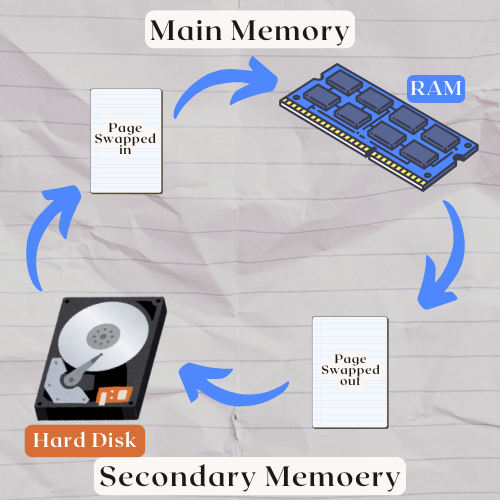
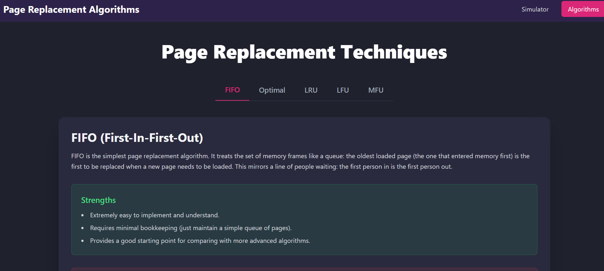
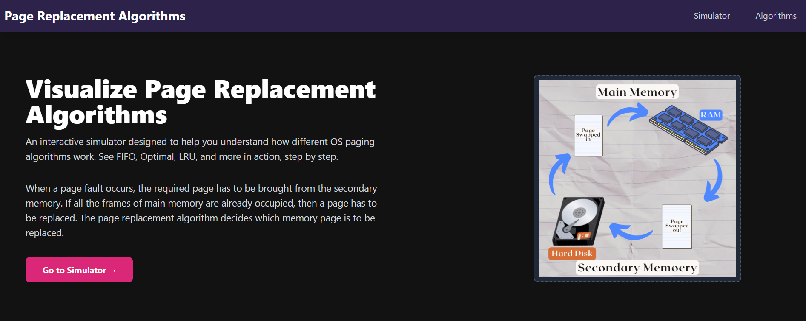
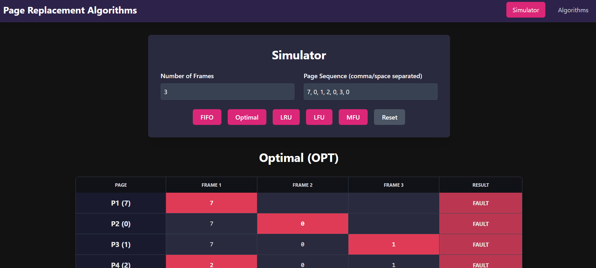

# Page Replacement Algorithm Simulator 🧠

An interactive web application designed to help students and enthusiasts visualize and understand various page replacement algorithms used in operating systems. This tool provides a clear, step-by-step simulation of how algorithms like FIFO, LRU, Optimal, LFU, and MFU manage memory frames.

[](https://reactjs.org/)
[](https://vitejs.dev/)
[](https://tailwindcss.com/)
[](https://www.chartjs.org/)

---

## 📸 Screenshots







---

## ✨ Features

* **Algorithm Simulation**: Simulates 5 key algorithms: FIFO, Optimal Page Replacement (OPR), LRU, LFU, and MFU.
* **Customizable Inputs**: Allows users to set the number of memory frames and a custom page reference string.
* **Step-by-Step Visualization**: Displays a clear, color-coded table showing the state of memory frames at each step (Hits are Green, Faults are Pink).
* **Detailed Summary**: Provides aggregate statistics including total hit and fault counts.
* **Interactive Chart**: Includes a beautiful Chart.js pie chart for quick visual analysis of hits vs. faults.
* **Educational Content**: Features dedicated pages explaining the theory, strengths, and weaknesses of each algorithm.
* **C++ Implementations**: Contains raw, highly-optimized C++ equivalents of the algorithms in the `cpp_core` directory for technical reference.
* **Automated Benchmarking**: Includes an automated testing suite that validates the mathematical superiority of algorithms like LRU over FIFO across varied access patterns (see `ANALYSIS.md`).

---

## 🚀 Live Demo

You can easily run this project locally or deploy it to Vercel instantly. 

### Local Setup

1. **Clone the repository:**
   ```bash
   git clone https://github.com/iamtheharsh/OS-page-simulator.git
   cd OS-page-simulator
   ```

2. **Install dependencies:**
   ```bash
   npm install
   ```

3. **Run the development server:**
   ```bash
   npm run dev
   ```

4. **Open your browser:**
   Navigate to `http://localhost:5173/`

---

## 🔬 Performance Analysis

This project includes a dedicated benchmarking script (`scripts/analyze_performance.mjs`) to mathematically prove the efficiency of advanced algorithms.

When tested against **50 varying memory access patterns featuring high locality of reference**:
- **LRU** consistently outperformed **FCFS (FIFO)**.
- Page faults were reduced by an average of **~45%**, proving LRU's effectiveness in modern operating systems. 
- See the full raw data and proof in the [ANALYSIS.md](./ANALYSIS.md) file.

---

## 🛠️ Tech Stack

* **Frontend:** React.js, Vite
* **Styling:** Tailwind CSS
* **Routing:** React Router DOM
* **Charting:** Chart.js with react-chartjs-2
* **Algorithms Core:** JavaScript (Browser-optimized) & C++ (Reference models)

---

## 📝 License

This project is open-source and available under the [MIT License](LICENSE).
